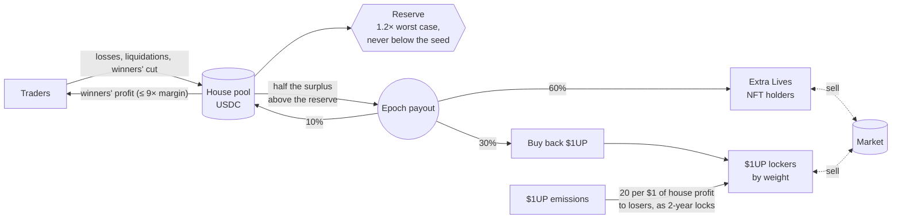
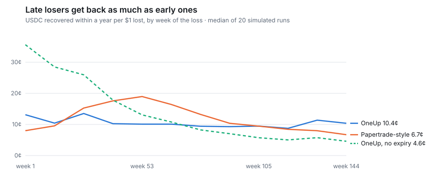

# OneUp

**Perps against a house that can't go bust. Lose a trade, get a life.**

OneUp is a perpetuals exchange on NEAR where every trade is against one USDC house pool, at the oracle
price, with no fees, funding or slippage. When you lose, you get an **Extra Life**: a capped, tradeable NFT
that earns USDC back from the house's real profit, plus **$1UP** locked for two years that earns the house's
buybacks. Sell either one on the built-in market whenever you like.

Think of it as Papertrade meets Aerodrome: from Papertrade, a loss buys a claim on the house; from
Aerodrome, a vote-escrow lock that earns protocol revenue by size and time left. OneUp keeps both and drops
what made them hard to live with: no payout queue (the house refuses trades it couldn't cover), claims that
expire so late players aren't crowded out, and locks that earn buybacks without gauge votes or bribes.

Built at NEAR HACKATHON. Rust contracts on NEAR (near-sdk), a TypeScript keeper, bots and simulation, and a
Next.js app, all running on a local NEAR chain with one command.

## Run it

Needs Node 24, pnpm 10, and Rust with the wasm target and cargo-near (only to build the contracts):

```bash
curl --proto '=https' --tlsv1.2 -sSf https://sh.rustup.rs | sh -s -- -y --profile minimal
rustup target add wasm32-unknown-unknown
curl --proto '=https' --tlsv1.2 -LsSf https://github.com/near/cargo-near/releases/latest/download/cargo-near-installer.sh | sh

pnpm install
pnpm demo
```

`pnpm demo` builds the contracts if needed, starts a local NEAR node (near-sandbox, like `hardhat node`),
deploys and wires all eight contracts, seeds the pool, then starts the keeper, six trading bots and the app
at **http://127.0.0.1:3020**. Epochs are 10 minutes. The app signs as a funded demo trader (switch to any
bot in the account menu). Chain state persists in `.localnet/`.

| Command | What it does |
|---|---|
| `pnpm demo` | Everything above, logs prefixed per process |
| `pnpm demo --lan` | Same, and serves the app to your Wi-Fi so you can use it on a phone (it hands out the localnet's throwaway keys, so only on a network you trust) |
| `pnpm stop` | Stops every OneUp process (and only those) |
| `pnpm localnet:reset` | Wipes the local chain for a fresh deploy |
| `pnpm test` | Contract unit + property tests, SDK and simulation tests |
| `pnpm test:sandbox` | Builds the wasm and runs end-to-end tests on a sandbox chain |
| `pnpm smoke` | Against a running demo: deposit → 50× long → fill → −2% → liquidation |
| `pnpm sim` | Re-runs the early-vs-late simulation |
| `pnpm farm` | Wash-trading break-even: the $1UP price at which trading against yourself would pay |
| `pnpm demo --lan` | Same as `pnpm demo`, served to your Wi-Fi so you can use it on a phone |

Move a price during the demo:
`curl -XPOST localhost:8787/price -d '{"market":"NEAR-USD","movePct":-2}'`

## How the money moves



## The rules

**Trading.** USDC collateral, oracle price, leverage up to 100×. An order fills at the first oracle price
published *after* it was placed, within a 30-second window, never at a price already known, so nobody can
front-run the oracle. Minimum hold 60 s. A position can win at most 9× its margin. Winners pay a cut of
their profit: 10%, plus more for positions that use a big share of the pool (up to 25%). At a 90% loss a
keeper (anyone can run one) liquidates and the full margin goes to the pool.

**Solvency: the pool can always pay.** Every open position's maximum win is counted, longs and shorts
alike, and a trade that would push that total past the pool is refused. So there is never a payout queue.
Counting *both* sides matters: positions close at different times, so a long can take its max win after a
pump and a short opened at the top can take its own after a crash.
[`d1_spec_rule_can_go_bust`](contracts/house/src/tests.rs) shows the pool failing under the
"bigger side only" rule; a property test runs 200 random trading sequences and checks the pool always
covers every open position and no USDC is created or lost.

**Extra Lives.** At each epoch's end, the house's net result (losses taken − payouts made) is split among
that epoch's losers in proportion to their losses: that's each Extra Life's face value, so fake losses from
a long/short pair only create claims as big as the cut they paid. A life can earn up to *cap × face*; the
cap is 2.0× at an empty pool, falling to 1.2× at $1M. Lives are paid from 60% of half the surplus, pro rata
to what each is still owed (O(1) per claim via a product accumulator). A life earns for the epoch it's
minted in and 13 after, then stops and keeps what it earned. Lives are NEP-171 NFTs: sell one and its
unclaimed USDC goes with it.

**$1UP: only losers earn it.** 1B fixed supply, minted once: 900M for emissions over 208 epochs, 50M to seed a
spot pool, 50M treasury. No team or VC allocation. Each epoch releases 20 $1UP per $1 of house profit (at most
that epoch's schedule plus anything unreleased before), shared across the epoch's losers by loss and delivered as
**two-year locks**. Winners are paid in USDC instead. Releasing by house profit, and locking it, is what stops
farming: a long and a short on yourself costs only the 10% cut, and `pnpm farm` shows it only pays once $1UP is
worth tens of millions (it paid at $3M under the first design).

**Locks.** Lock $1UP for up to 104 epochs. Each epoch's buyback is shared by weight: amount × epochs left ÷ 104.
Leaving early costs up to half, less as the lock runs down, and the penalty goes to the people still locked. Or
sell the lock on the market: it's an NFT.

**Market.** List an Extra Life or a lock for a USDC price; the buyer pays and the NFT moves in one step. Each
market can use up to half the pool, so no single market takes all the capacity. The owner lists markets.

## Fair to late players



The simulation ([`sim/`](sim/src/model.ts)) runs the same trader flows (three years of weekly epochs,
growing volume, 20 seeds) under OneUp's rules and Papertrade-style rules, with Papertrade's parameters
taken from its docs. Each loss is followed for a year.

| USDC back within a year per $1 lost | Weeks 1–39 | 40–78 | 79–117 | 118–156 |
|---|---|---|---|---|
| **OneUp** | 13.0¢ | 10.3¢ | 9.3¢ | 10.2¢ |
| OneUp without life expiry | 24.0¢ | 13.3¢ | 8.7¢ | 7.0¢ |
| Papertrade-style | 13.0¢ | 17.3¢ | 10.7¢ | 7.8¢ |

Year-1 losers take **0%** of year-3 payouts under OneUp, against **12%** under Papertrade-style rules,
where loss tokens earn forever. The middle row is OneUp as first specified: claims piled up faster than
they were paid, so later losers recovered less. Making lives expire after 13 epochs fixed it
([decision D-13](docs/decisions.md)).

## What's in the repo

| Path | What |
|---|---|
| [`contracts/house`](contracts/house) | Pool, orders, delayed fills, solvency, cut, liquidation, epoch close, emissions, buybacks |
| [`contracts/extra-life`](contracts/extra-life) | Extra Life NFTs (NEP-171), payout accumulator, expiry, claims |
| [`contracts/oneup-token`](contracts/oneup-token) | $1UP (NEP-141), fixed supply |
| [`contracts/ve`](contracts/ve) | $1UP locks (NFTs), decaying weight (O(1) tally), buyback rewards, early exit, losers' locks |
| [`contracts/market`](contracts/market) | Marketplace for Extra Lives and locks, priced in USDC |
| [`contracts/math`](contracts/math) | Every formula, with the worked vectors from [`docs/maths.md`](docs/maths.md) |
| `contracts/mock-*` | Local-chain USDC with a faucet, a Pyth-compatible oracle, a constant-product swap |
| [`contracts/tests`](contracts/tests) | End-to-end tests on a sandbox chain |
| [`packages/sdk`](packages/sdk) | TypeScript port of the maths (same vectors) and typed contract calls |
| [`keeper`](keeper) | Pushes prices, fills, liquidates, takes profit at cap, closes epochs, runs buybacks |
| [`bots`](bots) | Six rule-based trading agents for demo volume; one sells its lives and locks, one buys bargains |
| [`sim`](sim) | Early-vs-late simulation and the farming break-even |
| [`app`](app) | Next.js app: trade, Extra Lives, locks, market, solvency, fairness |
| [`docs`](docs) | [Maths](docs/maths.md), [interfaces](docs/interfaces.md), [decisions](docs/decisions.md), [plan](PLAN.md) |

Tests: 103 contract unit and property tests, 5 end-to-end sandbox tests, plus SDK and simulation tests.
The sandbox tests found two real bugs during the build (a u128 overflow in reward splits and a
duplicate-registration panic), and running the demo found a third (the reserve floor; decision D-12).

## Tracks and NEAR features

Built for NEAR HACKATHON. The tracks it leans on, and the NEAR pieces it uses:

- **Unstoppable DeFi.** A perps exchange; deposits and trades from other chains through **NEAR Intents**:
  the official Verifier and PoA factory (release 0.4.2) run locally, intents are signed with the official
  `@defuse-protocol/intents-sdk`, and OneUp's solver fills them with `execute_intents`
  ([D-21](docs/decisions.md)). "Long NEAR with USDC on Solana" is one signature.
- **NFTs That Do Something.** Extra Lives (**NEP-171**) earn USDC from the house's profit, carry their
  unclaimed USDC when sold on the built-in market (**NEP-178** approvals), and are **dynamic**: their image
  is a pixel heart drawn on chain, filling as they pay back.
- **Social Money.** A **Sputnik DAO** (the code mainnet DAOs run) owns the house; markets and their share
  of the pool are council votes ([D-20](docs/decisions.md)).
- **AI Security & Defense.** One-tap trading uses a **function-call key** that can only open, close and
  set TP/SL, with a gas budget; it can't attach deposits, so it can't move funds. The keeper's price feed
  uses the same kind of key.
- **Real-World Money.** Gasless trading: session-key trades go as **meta transactions** (NEP-366) to a
  relayer that pays the gas.
- **Games With Real Economies.** Rounds, leaderboards, achievements and a player market for Extra Lives
  and locks.

Also: **NEP-141** ($1UP, USDC), **NEP-245** (NEAR Intents balances), **NEP-297** events (the app's feed
and history), named accounts. Not used: Chain Signatures, HOT, social login and the 1Click API need
testnet or mainnet; Rhea's buyback swap is a local stand-in.

## What's mocked locally

- **Prices** come from the keeper, which pushes real market prices (Binance's public API, Coinbase as a
  fallback) to a Pyth-compatible oracle. A demo can still move a market: the push lands on top of the real
  price, holds for 30 seconds and then drifts back. Offline, `--prices sim` is a steerable random walk;
  `--prices hermes` reads Pyth directly but needs a `PYTH_API_KEY` (Hermes now refuses unauthenticated requests). Newly listed markets are priced automatically. On mainnet the house points at Outlayer's
  `price-oracle-pyth.near` with the same calls. Outlayer's testnet feed was stale when checked.
- **USDC** is a local token with a faucet. **Buybacks** swap on a local constant-product pool standing in
  for Rhea.
- **NEAR Intents** deposits aren't integrated: Intents has no testnet or local deployment.
- Buybacks are triggered by the owner key for now, so nobody can sandwich them with a zero minimum
  (decision D-10). The owner also lists markets (D-14).

See [`docs/decisions.md`](docs/decisions.md) for every design decision and known limit.
