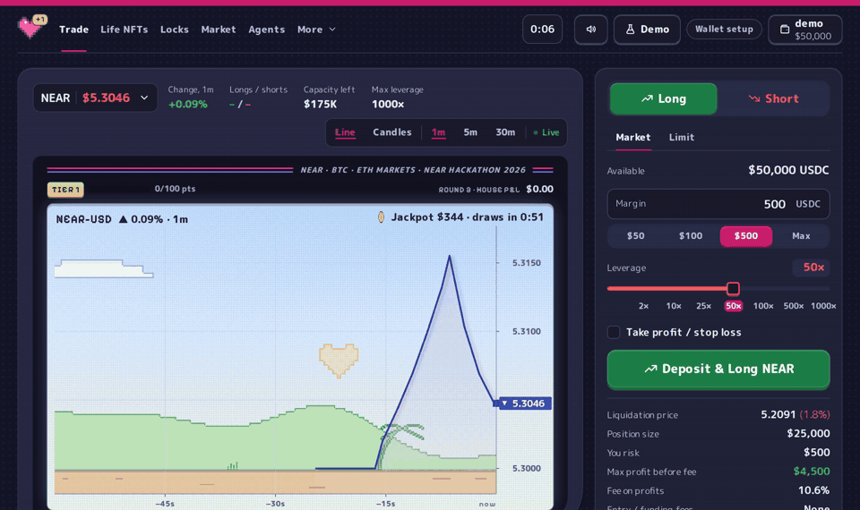

# OneUp

**Perpetuals on NEAR where a losing trade can leave you a Life NFT: an NFT that holds USDC and a share of
the house's future profit, which you can claim or sell.**

When one sells, the buyer gets its unclaimed USDC and every payout still to come. A purchase names the listing
the buyer saw, so one the seller claimed or repriced in the meantime fails and refunds the buyer.



A NEAR HACKATHON entry for **NFTs That Do Something**, **Unstoppable DeFi**, **Agent Economy** and **Open Innovation**. It is live
on NEAR testnet at **https://oneup.markets** (the app is at https://app.oneup.markets), and runs as a fuller
local demo, both with test USDC; nothing is on mainnet. All of it was written in the
hackathon window: the first commit is 20 October 2026, the day after the announcement
(`git log --reverse --format=%ad | head -1`).

To review it:

- **In a minute, with nothing installed:** `node scripts/check-live.mjs` reads the live contracts and prints
  `PASS` or `FAIL` for each claim. See [Check the claims](#check-the-claims).
- **Where each NEAR integration is in the code, and where it runs:** [What NEAR does here](#what-near-does-here).
- **How the parts fit:** [The path through the code](#the-path-through-the-code).
- **What is a mock or runs only locally:** [What is real and what is mocked](#what-is-real-and-what-is-mocked).
- **Who can change what on testnet:** [Who controls what on testnet](#who-controls-what-on-testnet).
- **How a Life changes hands, and the seller attacks it's tested against:** [How a Life changes hands](#how-a-life-changes-hands-and-what-stops-the-seller).

## The problem

On a perpetuals venue that trades against its users, a trader's loss is the venue's profit, and a liquidated
position leaves the trader nothing to hold, sell or claim.

OneUp gives losers part of the house's profit back, as an asset they own. When a round closes with the house
in profit, each wallet with a net loss in that round gets a **Life NFT**, an NFT that collects a share of the
house's profit for the next 13 rounds, up to a payout limit of 1.2–2× its face value. A round pays out only from
the surplus above the pool's reserve, so a profitable round can still pay nothing. Losers also get $1UP tokens,
locked for 104 rounds; lockers share the house's buybacks. A Life can be claimed, kept or sold: the buyer gets
its unclaimed USDC and its future payouts. Recovery depends on future house profit and can be zero.

## What is new, and what is borrowed

- **A loss becomes an asset with a price.** The claim on the house's profit is an NFT, so a trader who would
  rather have cash now can sell it, and a buyer can price it against the USDC it can still pay. See
  [the Life NFT](contracts/extra-life/src/lib.rs) and [the market](contracts/market/src/lib.rs).
- **The claim can't be emptied under a buyer.** Claiming a Life's USDC drops its approvals, and a purchase
  names the `approval_id` and price the buyer saw, so a Life claimed or repriced after the buyer looked fails
  with `Listing changed` and the payment is refunded (`claim` in the Life NFT, `ft_on_transfer` in the market).
- **Recovery is paid from surplus only.** Lives are sized from the round's house profit, never above the
  wallet's loss, and paid only from what the pool holds above its reserve
  ([maths](docs/maths.md), `face_value` and `reserve` in [contracts/math](contracts/math/src/lib.rs)).
- **An agent can trade the claims, not only the perps.** The MCP server's `market_listings`, `buy_listing` and
  `claim_lives` let an agent buy a Life listed below what it can still pay, then collect it.

Borrowed: loss-linked claims from Papertrade and revenue-sharing locks from Aerodrome. Trading against a
pooled house with capped profit is an existing design; OneUp doesn't claim it.

## What NEAR does here

| NEAR feature | What OneUp does with it | Code | Checked by | Runs on |
|---|---|---|---|---|
| NEP-171 NFT, NEP-177 metadata, NEP-178 approvals | A Life NFT carries a USDC claim; transferring it moves the claim. Its picture is an SVG built from its state on every read | [contracts/extra-life/src/lib.rs](contracts/extra-life/src/lib.rs): `mint_batch`, `claim`, `heart_svg`. Locks: [contracts/ve/src/lib.rs](contracts/ve/src/lib.rs), `lock_svg` | [extra-life tests](contracts/extra-life/src/tests.rs), [ve tests](contracts/ve/src/tests.rs), sandbox [market.rs](contracts/tests/tests/market.rs) | Testnet, local |
| NEP-141 `ft_transfer_call` | Every USDC movement into a contract is a transfer call with a JSON message: a deposit, a deposit that opens a trade, a round's pot to the Lives, a purchase | `ft_on_transfer` in [house/trading.rs](contracts/house/src/trading.rs), [extra-life](contracts/extra-life/src/lib.rs) and [market](contracts/market/src/lib.rs) | Sandbox tests on built WASM in [contracts/tests/tests](contracts/tests/tests) | Testnet, local |
| NEP-178 `nft_approve` with a message | Listing for sale is one approval; the market records the `approval_id` it was given and sells only on that one | `nft_on_approve` and `ft_on_transfer` in [contracts/market/src/lib.rs](contracts/market/src/lib.rs) | Sandbox `a_life_claimed_and_listed_again_is_not_sold_to_the_earlier_buyer` | Testnet, local |
| NEP-297 events | The house logs every trade, round and payout as `standard: "oneup"` events; the indexers build history from them and ignore an event whose contract doesn't own its standard | [house/events.rs](contracts/house/src/events.rs), [app/src/lib/server/activity.ts](app/src/lib/server/activity.ts) | [app/test/activity.ts](app/test/activity.ts) | Testnet, local |
| NEAR Intents (Verifier v0.4.2, unchanged binary) | One signed intent swaps a bridged token for USDC, deposits it and opens a trade. The house accepts a named account only from the Verifier, and lets such a deposit trade only the USDC it brought | House: `set_intents`, `DepositMsg::For` and `DepositMsg::Open` in [house/trading.rs](contracts/house/src/trading.rs). Client: [app/src/lib/intents.ts](app/src/lib/intents.ts). Solver and simulated bridge: [app/src/lib/server/intents.ts](app/src/lib/server/intents.ts) | House tests `intents_open_trades_only_the_deposit`, `intents_refused_open_keeps_the_deposit`, `intents_dust_cannot_open_a_balance`. End to end on the local chain, in [scripts/judge-e2e.ts](scripts/judge-e2e.ts) (`pnpm test:judge`, and in CI): the app's client code signs an intent, the solver fills it on the Verifier, the USDC leaves the Verifier and the trade opens with exactly that margin; an intent asking for a bigger trade than it pays for places no order and its deposit stays in the free balance. The bridge deposit before it is simulated | Local |
| Sputnik DAO v2 (unchanged mainnet code) | The DAO owns the house, the Life NFTs and the oracle; markets, parameters and the keeper change by council vote | [scripts/deploy.ts](scripts/deploy.ts) deploys it; `add_proposal` and `act_proposal` in [packages/sdk/src/client.ts](packages/sdk/src/client.ts) | [scripts/judge-e2e.ts](scripts/judge-e2e.ts) asserts `get_owner` on all three | Local |
| Function-call access keys, NEP-366 meta transactions | One-tap trading: a session key that can call only `place_open`, `place_close` and `set_triggers` on the house, relayed so the trader pays no gas. Two keeper loops sign with function-call keys: prices (`push_prices` on the oracle) and risk (`liquidate`, `take_profit`, `hit_target`, `hit_stop` on the house). The keeper's other jobs (fills, expiries, round closes, vault moves) still sign with the keeper account's full-access key | [app/src/lib/session.ts](app/src/lib/session.ts), [app/src/app/api/relay/route.ts](app/src/app/api/relay/route.ts), [app/src/lib/server/relay.ts](app/src/lib/server/relay.ts), [keeper/src/index.ts](keeper/src/index.ts) | [app/test/session.ts](app/test/session.ts), [app/test/relay.ts](app/test/relay.ts) | Session keys and relayer: local. Keeper keys: testnet, local |
| Block randomness | The jackpot draw picks the winning ticket from `env::random_seed()` | `draw_jackpot` in [house/treasury.rs](contracts/house/src/treasury.rs) | House test `losers_get_tickets_and_one_takes_the_jackpot` | Testnet, local |
| Wallets | NEAR Connect (`@hot-labs/near-connect`) for testnet wallets | [app/src/lib/near-wallet.ts](app/src/lib/near-wallet.ts) | [app/test/wallet.ts](app/test/wallet.ts) | Testnet |
| NEP-413 signed messages | A Life's holder room opens only for the account holding it now: the wallet signs a message naming the Life, and the server checks the signature, that the key is the account's full-access key, and the Life's owner on chain | [app/src/app/api/life-holder/route.ts](app/src/app/api/life-holder/route.ts), [app/src/lib/nep413.ts](app/src/lib/nep413.ts), [app/src/lib/server/holder.ts](app/src/lib/server/holder.ts) | [app/test/holder.ts](app/test/holder.ts) | Testnet, local |
| MCP agents | Thirteen tools over the same SDK the app uses; each action is journalled with the agent's stated reason | [mcp/src/index.ts](mcp/src/index.ts), [mcp/src/agent.ts](mcp/src/agent.ts) | `pnpm agent`, then the app's Agents tab | Local |

Not used: Chain Signatures, NEAR AI and a real cross-chain deposit (the bridge is simulated; see
[what is mocked](#what-is-real-and-what-is-mocked)). A Life is not a NEAR account of its own: the Life
contract holds the USDC and keeps each token's share.

### By track

| Track | What OneUp does for it | What it doesn't do |
|---|---|---|
| NFTs That Do Something (`nfts`) | An NFT that owns money: a Life collects USDC from the house's profit for 13 rounds, pays its owner on `claim`, redraws its picture as it fills, and sells with its unclaimed USDC and future payouts attached. Locks are NFTs too, earning buybacks. Each Life has its own history and a holder room only its current holder can open. How control passes, and the seller attacks it's tested against, are in [How a Life changes hands](#how-a-life-changes-hands-and-what-stops-the-seller) | No sub-account per NFT, no royalties |
| Unstoppable DeFi (`defi`) | A perpetuals house whose pool must cover every open position's maximum win before an order is accepted; deposits through NEAR Intents; on testnet nobody holds a key to the nine contracts | The cross-chain leg is simulated and there is no 1Click integration (no quotes, status tracking, REFUNDED/FAILED handling or dry run). A trusted keeper fills orders and the oracle is a mock. The owner account can halt markets, swap the oracle and move the pool's idle USDC; see [Who controls what on testnet](#who-controls-what-on-testnet) |
| Agent Economy (`agents`) | An agent that earns and spends: it trades, buys Lives on the market and claims them, paying in USDC, with a journal of what it did and why | Local demo only; the agent doesn't hire other agents or pay for APIs, and its risk limits are instructions, not code |
| Open Innovation (`open`) | A trading loss becomes an asset with a price. The Life is a claim on the house's later profit that its owner can hold, claim or sell, and a buyer can value it against the USDC it can still pay. That turns a venue's profit into a market in its losers' claims, which agents can trade as well as people | Test money on testnet only. The house's profit, and so what Lives pay, comes from the author's bots trading against it, so the market in Lives has no outside buyers yet |

## The path through the code

How a losing trade becomes a Life, and where each step lives.

| Step | What happens | Where |
|---|---|---|
| 1. Deposit | USDC arrives by `ft_transfer_call`; an empty message credits the free balance, `{"open":…}` also places an order | `ft_on_transfer` in [house/trading.rs](contracts/house/src/trading.rs) |
| 2. Order | `place_open` moves the margin into a pending order and reserves the position's maximum win; it is refused unless the pool covers all of them and the market has room | `internal_place_open` in [house/trading.rs](contracts/house/src/trading.rs), `change_liability` in [house/lib.rs](contracts/house/src/lib.rs), `max_liability` in [math](contracts/math/src/lib.rs) |
| 3. Fill and liquidation | The keeper pushes prices and calls `fill` or `liquidate`; an order fills only at a price published after it was placed | [keeper/src/orders.ts](keeper/src/orders.ts), [keeper/src/prices.ts](keeper/src/prices.ts), `fill` and `liquidate` in [house/trading.rs](contracts/house/src/trading.rs), [house/oracle.rs](contracts/house/src/oracle.rs) |
| 4. Round close | Anyone can call `close_epoch`; it works in bounded steps (begin, mint, wait, expire, pay) while trading continues | [house/epochs.rs](contracts/house/src/epochs.rs) |
| 5. Issuance | Each wallet with a net loss gets a Life (`face_value`) and a $1UP lock. A batch is removed only when both contracts confirm it, and a failed receipt is retried without duplicating | [house/recovery.rs](contracts/house/src/recovery.rs), `mint_batch` in [extra-life](contracts/extra-life/src/lib.rs), [ve](contracts/ve/src/lib.rs), [house/emissions.rs](contracts/house/src/emissions.rs) |
| 6. Payout | Each later close sends the surplus above the reserve to the Life contract, which shares it across the Lives still earning; `claim` pays the owner and drops the token's approvals | `ft_on_transfer` and `claim` in [extra-life](contracts/extra-life/src/lib.rs) |
| 7. Sale | The owner approves the market with a price; a buyer's USDC transfer names the price and `approval_id` | [contracts/market/src/lib.rs](contracts/market/src/lib.rs) |
| 8. Buybacks and jackpot | Part of the surplus buys $1UP for lockers; interest on idle pool USDC funds a jackpot drawn among the period's losers | [house/buyback.rs](contracts/house/src/buyback.rs), [house/treasury.rs](contracts/house/src/treasury.rs) |
| 9. Reads | The app reads contract views directly. History and leaderboards come from the events: an indexer on the author's machine writes them to Redis, and the hosted app's API routes read from there | [packages/sdk/src/client.ts](packages/sdk/src/client.ts), [scripts/testnet-indexer.ts](scripts/testnet-indexer.ts), [app/src/lib/server/published.ts](app/src/lib/server/published.ts), [app/src/app/api](app/src/app/api) |

The integer maths is one crate, [contracts/math](contracts/math/src/lib.rs), used by the contracts and mirrored in
[packages/sdk/src/maths.ts](packages/sdk/src/maths.ts) for previews. States and their transitions are listed in
[docs/STATES.md](docs/STATES.md).

## How a Life changes hands, and what stops the seller

A Life's money belongs to the token, not to a wallet. The Life contract keeps each Life's share of every pot and
what it has claimed under its token id (`life_info(token_id).claimable`), and `claim` pays only the token's current
owner. So control passes with the NEP-171 transfer itself: from that block the new owner is the only account that
can claim, and all of the Life's unclaimed USDC and every later payout go with it. A pot that lands while a Life
is listed belongs to the Life, so a buyer who completes the purchase gets it.

Every way we found for a seller to keep money that was sold, and what stops it. Unit tests are in
[contracts/extra-life/src/tests.rs](contracts/extra-life/src/tests.rs); sandbox tests run on the built WASM in
[contracts/tests/tests/market.rs](contracts/tests/tests/market.rs).

| How a seller could try it | What stops it | Test |
|---|---|---|
| Keep claiming after the sale | `claim` checks the token's current owner; the claimable amount moves with the token | `only_owner_claims`, `claimable_moves_with_the_token` |
| Claim the USDC, then let the old listing sell the emptied Life | `claim` drops the Life's approvals, and a purchase names the `approval_id` and price the buyer saw, so a stale purchase fails with `Listing changed` and the buyer is refunded | `claim_drops_the_approvals`; sandbox `a_life_claimed_and_listed_again_is_not_sold_to_the_earlier_buyer` |
| Reprice or empty a listing after the buyer looked | The same binding of a purchase to the listing's `approval_id` and price | Sandbox `a_listing_cannot_change_under_the_buyer` (shown on a $1UP lock, which lists the same way) |
| Send the Life with `nft_transfer_call` to a contract that claims it and hands it back with its listing | A Life emptied during a transfer call comes back without its old approvals, and a nested transfer call can't erase that mark | `a_life_emptied_during_a_transfer_call_returns_without_its_old_approvals`, `a_nested_transfer_call_cannot_wipe_the_mark`, `a_life_untouched_during_a_transfer_call_gets_its_approvals_back` |
| Take the buyer's USDC without delivering the Life, by giving the purchase too little gas | At every gas level the buyer either gets the Life and the seller the price, or the purchase fails and the buyer is refunded | Sandbox `buyer_gas_cannot_separate_nft_delivery_from_payment` |
| Have a refused transfer strand the Life or its listing | The Life comes back and, with nothing changed, its listing survives | Sandbox `a_refused_transfer_call_returns_the_life_with_its_listing` |
| A round's mint retried after the Life was sold lands back with the seller, or resets its terms | A retried mint keeps the current owner and terms | `retrying_a_mint_after_sale_and_payout_keeps_the_current_owner_and_terms` |
| A failed USDC transfer during `claim` records a payout that never arrived | A failed claim restores exactly its amounts | `failed_claim_restores_exactly_its_amounts` |

What this doesn't cover: the Life contract's owner can appoint a different house, which could mint Lives that share
later pots (see [Who controls what on testnet](#who-controls-what-on-testnet)). A Life is not an account of its own:
the Life contract holds the USDC.

**Each Life's history.** A Life's page lists every event in its life from the chain: its mint, every transfer and
market sale, and every claim, each with its transaction. The indexer builds it from the Life contract's NEP-171
events and the market's `sold` events; a sale's transfer is shown once, as the sale. The contract logs a claim only
as "<account> claimed <total>", so the claimed token ids are read from the `claim` call's arguments, and a claim of
several Lives at once shows its total with the number of Lives it covered. Code: `toItems`, `lifeClaimLogs` and
`lifeHistoryFor` in [app/src/lib/server/activity.ts](app/src/lib/server/activity.ts), `backfillLives` in
[scripts/testnet-indexer.ts](scripts/testnet-indexer.ts) (it reads the Lives minted before histories were kept),
[app/src/components/LifeHistory.tsx](app/src/components/LifeHistory.tsx). Tests: the three Life history tests in
[app/test/activity.ts](app/test/activity.ts).

**The holder room.** A Life's page has a room only its current holder can open. The wallet signs a NEP-413 message
naming the Life (no transaction, no fee). The server checks the signature, that the key is a full-access key of the
signing account, and that the account owns the Life on chain at that moment, then shows how the holder got it, what
they have claimed since, what is unclaimed and, if they bought it, their result so far. Ownership is checked on
every opening, so once a Life is sold the room opens for the buyer and refuses the seller. A signed message opens it
for five minutes. Code: [app/src/app/api/life-holder/route.ts](app/src/app/api/life-holder/route.ts),
[app/src/lib/server/holder.ts](app/src/lib/server/holder.ts), [app/src/lib/nep413.ts](app/src/lib/nep413.ts),
[app/src/components/HolderRoom.tsx](app/src/components/HolderRoom.tsx). Tests: [app/test/holder.ts](app/test/holder.ts)
signs with near-api-js's own NEP-413 signer and checks that a message naming another Life, an expired one or one
signed for another site is refused.

## Try it live

| Step | Do | See |
|---|---|---|
| 1 | Open https://oneup.markets, then **Open the app** | What OneUp is, then the app's power-on screen (any key skips it) |
| 2 | Look around before connecting | The Trade screen with no wallet: the live chart and the long/short split. Any action asks for a wallet |
| 3 | Open the **Market** and **Jackpot** tabs | The Lives and locks the bots have listed; the jackpot's prize, its countdown and every past draw |
| 4 | **Connect wallet** (a NEAR testnet wallet such as Meteor; see [wallet setup](docs/NEAR_WALLET_SETUP.md)), then in the account menu **Register test tokens** and **Get 1,000 test USDC** | Test USDC in your wallet |
| 5 | Open a 1000× long on NEAR-USD | The order fills on the next price. A small move against it liquidates it, with the LIQUIDATED banner |
| 6 | Wait for the round to close (the countdown is in the header), then open **Life NFTs** | If the house ended the round in profit, your Life NFT, its picture filling as it pays |
| 7 | **Claim** what it has collected, or list it on the **Market** | USDC in your wallet, or your listing |

The keeper and bots run from the author's machine, along with an indexer that feeds the app's history and
leaderboards. The keeper also tops up the contracts' storage and the bots' gas.

### Who controls what on testnet

The testnet contracts are accounts under `v5.oneupmarkets.testnet`. None of them holds an access key, so nobody can
deploy new code to them. But `v5.oneupmarkets.testnet` itself holds a full-access key and is the owner of the house,
the Life NFTs and the oracle, and the house's operator. As owner it can:

| Contract | Method | What it lets the owner do |
|---|---|---|
| House | `set_market_live`, `add_market`, `set_max_leverage`, `set_capacity` | Halt new trades in a market, add markets, change leverage and capacity limits |
| House, oracle | `set_oracle` on the house, `set_pusher` on the oracle | Choose where prices come from and who may push them. A price move can liquidate open positions into the pool |
| House | `set_params` | Change trading and pool parameters. The contract bounds none of the values; it only refuses to change the solvency rule while positions or orders are open |
| House | `set_vault`, then `deploy` | Point the vault at any account and send it the pool's deployable USDC: everything above 1.2 × the worst-case payout of open positions plus the float, which `set_params` sets. `deploy` accepts the owner as well as the keeper (`assert_keeper` in [house/lib.rs](contracts/house/src/lib.rs), `deploy` in [house/treasury.rs](contracts/house/src/treasury.rs)) |
| House | `set_keeper`, `set_operator`, `set_owner`, `set_intents`, `set_life`, `set_swap`, `set_token_and_ve`, `set_marketplace` | Replace the keeper, the operator or itself, and repoint the house at other Intents, Life, swap, token, lock and marketplace contracts. With `set_life`, later rounds' pots would go to a different Life contract |
| Life NFT | `set_house` | Appoint a different house. The house is the only account that can mint Lives and expire rounds, so a new one could mint Lives that share later pots with the existing ones. What a Life has already been allocated stays its own |

It cannot take a trader's free balance, which only its owner can withdraw. It cannot claim or move a Life it doesn't
own, or change the marketplace, the $1UP token or the locks, which have no owner methods. The keeper,
`keeper.v5.oneupmarkets.testnet`, also holds a full-access key, which signs fills, expiries, round closes and vault
moves (see [What NEAR does here](#what-near-does-here)). In the local demo a Sputnik DAO is the owner instead; that
handover hasn't been made on testnet.

## Try it locally

Tested on Linux with Node 24.13.0, pnpm 10.18.3, Rust 1.99.1 (with the `wasm32-unknown-unknown` target) and
cargo-near 0.22.0, the versions CI uses.

| Step | Do | See |
|---|---|---|
| 1 | `pnpm install --frozen-lockfile` | Dependencies installed |
| 2 | `pnpm preflight --compile` | Every line ✓. Without cargo-near it also checks the tools needed to build it |
| 3 | `pnpm build:contracts` | Nine WASM files under `contracts/target/near/` |
| 4 | `pnpm demo:judge`, and leave it running | After about five minutes `Judge app: http://127.0.0.1:3021`; about a minute later `Ready.`, naming a prepared Life and a listing |
| 5 | Open http://127.0.0.1:3021 | The Trade screen, as the `demo` trader: the NEAR-USD chart, the order ticket with its potential recovery, and How recovery works |
| 6 | Open the **Life NFTs** tab | A Life from a prepared loss, with USDC available to claim and a remaining payout limit. **Claim** sends the USDC to the wallet |
| 7 | Open the **Market** tab | bot3's Life. bot3 claimed its USDC, then listed the Life for a fifth of its remaining payout limit; whatever later rounds have paid it since goes with it. **Buy** moves it to your Life NFTs, where its USDC and its future payouts are yours to claim |
| 8 | In a second terminal: `ONEUP_CONFIG=<path printed in step 4> pnpm test:judge` | Thirteen assertions pass in one to two minutes: fills, liquidation, Life minted, USDC claimed, sale, former owner refused, buyer claims, reserve admission, deployed hashes, DAO ownership, a NEAR Intents payment that opens a trade, and one that asks for more than it pays and is refused. `e2e.json` is written beside the config |
| 9 | On the Trade screen, open a 50× long on NEAR-USD; then `curl -XPOST 127.0.0.1:8887/price -H 'content-type: application/json' -d '{"market":"NEAR-USD","movePct":-2}'` | The keeper liquidates the position; when the 45-second round closes, a new Life appears on the Life NFTs tab |
| 10 | `pnpm agent` (needs `ANTHROPIC_API_KEY` or the `claude` CLI) | An AI agent trades as bot12; the **Agents** tab lists each action and the reason it gave |
| 11 | `pnpm verify` | About seven minutes: a secret scan, typechecks, Rust unit, property and sandbox tests, TypeScript tests and a production build, ending `Complete verification passed` |

`pnpm demo:judge` starts a fresh chain under `.judge/<time>/` on every run and never touches the regular demo.
It uses ports 3021 (app), 3130 (RPC), 8887 (price control) and 25567, and refuses to start if one is taken
(`ONEUP_JUDGE_APP_PORT=3022` and the like move them). Prices stay fixed until you steer them and no bots run.
The prepared sample is scripted and recorded in `prepared.json`; `pnpm demo:judge --empty` skips it. Ctrl-C
stops everything.

`pnpm demo` runs the ordinary demo instead: live prices, twelve bots and ten-minute rounds at
http://127.0.0.1:3020, with state kept in `.localnet/`.

## Check the claims

**On the live deployment, in about a minute.** You need Node 18 or newer and nothing else: no install, no wallet and no
keys, and it sends no transactions.

```bash
git clone https://github.com/ethboi/oneup && cd oneup
node scripts/check-live.mjs
```

It reads the contracts on NEAR testnet and prints `PASS` or `FAIL` for each claim, with the numbers behind it: nobody
holds a key to the nine contracts, prices are fresh, rounds keep closing, every open position's worst case fits inside
the pool, Lives come only from house profit, the USDC Lives received matches the rounds exactly, unclaimed USDC is
really in the contract, Lives have been sold and the buyer collected, and the pictures are on chain. It ends with what
it can't prove, including that the money is test money, the oracle is a mock and the traders are the author's bots. A
`FAIL` on prices or rounds usually means the keeper on the author's machine has stopped.

**In the code, by running the tests.**

| Claim | Code and regression | Run and see |
|---|---|---|
| Selling a Life transfers its payout rights | [Life NFT](contracts/extra-life/src/lib.rs), [market test](contracts/tests/tests/market.rs), [judge journey](scripts/judge-e2e.ts) | `pnpm test:judge`: the buyer owns and claims it; the former owner is refused |
| A purchase can't land on a changed listing | [Market](contracts/market/src/lib.rs), sandbox `a_life_claimed_and_listed_again_is_not_sold_to_the_earlier_buyer` | `pnpm test:sandbox`: a Life claimed and listed again at the same price refunds the earlier buyer |
| An NFT emptied during a transfer call can't sell on its old listing | [Life NFT](contracts/extra-life/src/lib.rs), [ve](contracts/ve/src/lib.rs), tests `a_life_emptied_during_a_transfer_call_returns_without_its_old_approvals` and `a_lock_emptied_…` | `pnpm test`: the token returns without its old approvals; one left untouched keeps them |
| A Life is never sized above its loss | [Maths](contracts/math/src/lib.rs), house `a_quiet_rounds_fees_dont_inflate_its_lives` | `pnpm test`: a quiet round's marketplace fees don't inflate the round's Lives or $1UP |
| Failed issuance keeps the obligation | [Recovery queue](contracts/house/src/recovery.rs), [receipt test](contracts/tests/tests/recovery.rs) | `pnpm test:sandbox`: a failure and retry keep the recipient and terms without duplicating rewards |
| Expiry stops future payouts, not allocated cash | [Life tests](contracts/extra-life/src/tests.rs), [UI accounting](app/test/life-economics.ts) | `pnpm test` and `pnpm test:ts`: expired cash stays claimable; the remaining payout limit is zero |
| Admission reserves the worst case | [House property tests](contracts/house/src/tests.rs) | `pnpm test`: random sequences of trades never let liability exceed the pool |

[The evidence index](docs/evidence/README.md) keeps earlier recorded runs, with the exact revisions they ran on.

## What is real and what is mocked

| Component | State |
|---|---|
| House, Life NFT, $1UP token, locks, marketplace | OneUp's own contracts, on testnet and the local chain |
| NEAR Intents | The official Verifier and PoA token factory (v0.4.2, unchanged binaries); intents signed with the official SDK. OneUp's own solver fills them with `execute_intents`. Bridge deposits are simulated; there is no real Ethereum or Solana deposit and no 1Click integration |
| Sputnik DAO | Local demo only (an operator account owns the testnet contracts). Unchanged mainnet Sputnik DAO v2 code; owns the house, the Life NFTs and the oracle. The council (the demo trader, bot4 and bot6) votes with disclosed test keys |
| Function-call keys, NEP-366 | Session keys limited to the house's trading methods; a local relayer. A trade-only key can still lose the trading balance |
| NEAR wallet | NEAR Connect 0.11.4 on testnet, described in [wallet setup](docs/NEAR_WALLET_SETUP.md). The local demo signs with its test accounts |
| AI agents | The MCP server and `pnpm agent`. The agent signs with a full-access local test key; its limits on margin, leverage and stop-losses are instructions, not enforced in code |
| Oracle | A mock with Pyth's interface. The keeper feeds it Binance prices (ordinary demo) or fixed prices (judge demo). Pyth through OutLayer is the plan and hasn't been tested on a real network |
| Swap, vault, USDC | Mocks: a constant-product swap for buybacks (Rhea is the plan), a vault paying 5% on idle pool USDC (lending through Chain Signatures is the plan), and test USDC with a faucet |
| Randomness | The jackpot draw uses NEAR's block random seed |

## Rules and limits

- **Trading.** USDC margin, up to 1000× leverage, and a maximum profit of 9× margin. No entry or funding fee;
  winners pay 10–25% of their profit. A 90% loss liquidates the position and takes its whole margin. A
  position can be closed after 60 seconds. Orders fill at an oracle price published after they were placed,
  by a trusted keeper. A limit order rests up to 24 hours, and can be cancelled after its first 30 seconds.
- **Admission.** The pool must cover the maximum win of every open position and pending open, longs and shorts
  together, so it can always pay; this doesn't remove oracle, owner, vault or implementation risk.
- **Life NFTs.** Sized from the round's house profit, up to the round's net losses, by each wallet's share
  of those losses: a Life's face value is never more than its loss. Lives share 60% of half the surplus above
  the reserve each round, two thirds to trader Lives and one third to Backer Lives.
- **$1UP.** 1B minted once: 900M released to losers over four years, 20 per USDC of the house profit behind
  their Lives, as 104-round locks; 50M for liquidity, 42.5M treasury and 7.5M for backers. Lockers earn
  buybacks by amount × time left; leaving early costs up to half.
- **Backing.** The local deployment starts with a $250K house seed and $100K of bot backing, which earn Backer
  Lives that never expire. These are prepared state, not users or traction.
- **Market.** Lives and locks are NFTs listed for USDC; sellers pay a 2% fee to the house. No price or buyer
  is guaranteed.
- **Jackpot.** The interest the idle pool earns in the vault (a mock), drawn every four rounds on testnet among
  wallets with a net loss since the last draw. Each dollar of net loss is a ticket, one ticket takes the whole
  prize, and with no tickets it rolls over.

The maths is in [docs/maths.md](docs/maths.md) and every decision in [docs/decisions.md](docs/decisions.md).

## AI agents

The MCP server (`mcp/`) gives any MCP client thirteen tools: `how_it_works`, `markets`, `account`,
`quote_trade`, `open_trade`, `close_trade`, `set_triggers`, `extra_lives`, `claim_lives`, `house`,
`market_listings`, `buy_listing` and `faucet`. An agent can treat a Life as an asset: buy one listed below the
USDC it can still pay, then claim it. Every action takes the agent's reason, and goes into a journal beside
the chain's state that the Agents tab shows.

```bash
pnpm mcp                      # stdio. Claude Code in this folder loads it from .mcp.json
ONEUP_ACCOUNT=bot3 pnpm mcp   # trade as another bot
pnpm agent                    # one autonomous session: the Claude API with ANTHROPIC_API_KEY, else the claude CLI
```

The server uses `ONEUP_CONFIG` if set, else the ordinary demo's `localnet.json`, else the newest judge chain.
By default the agent trades as bot12, which the rule-based bots leave alone.

## Economics

`pnpm test:economics` runs funded experiments against the real contracts: admission, inactive rounds and
expiry, an adverse house result, and two wallets farming each other; its report reconciles cash, fees and
remaining rights ([scope and results](docs/ECONOMIC_EXPERIMENTS.md)). `pnpm sim:sensitivity` models flat and
falling activity, negative edge and high utilisation across random seeds. These show how the mechanism
behaves; they don't prove demand or that recovery is sustainable. A [five-person research protocol](docs/USER_RESEARCH.md)
is prepared, with no results yet.

## Commands

| Command | Purpose |
|---|---|
| `pnpm preflight --compile` / `--judge` | Check build prerequisites / the built WASM and the judge demo's ports |
| `pnpm demo:judge` / `pnpm test:judge` | Isolated, controlled demo / its end-to-end check |
| `pnpm test:judge:ci` | A fresh isolated deployment, the end-to-end check and a Chromium test of listing, buying and claiming (run `pnpm exec playwright install --with-deps chromium` first) |
| `pnpm verify` | The full gate; writes source-bound logs to `.verification/` |
| `pnpm test` / `pnpm test:sandbox` / `pnpm test:ts` | Rust unit, property, SDK and model tests / integration tests on fresh WASM / app and keeper tests |
| `pnpm test:economics`, `pnpm sim:sensitivity`, `pnpm farm` | Funded experiments, adverse scenarios, farming comparison |
| `pnpm demo` | The ordinary demo: live prices and twelve bots |
| `pnpm mcp` / `pnpm agent` | The MCP server / one autonomous AI agent session |
| `pnpm verify:deployment` | Compare the deployed contracts with the local WASM |
| `pnpm localnet:reset` | Delete the ordinary demo's chain (the judge demo doesn't need it) |

## Built with

- **AI-written code.** OneUp was written with Claude Code (Anthropic's coding agent), directed and reviewed by
  the author. Commits it co-wrote carry a `Co-Authored-By: Claude` trailer, which is nearly all of them:
  `git log --grep='^Co-Authored-By: Claude' --oneline | wc -l`. No starter template or boilerplate was used.
- **Contracts.** near-sdk and near-contract-standards 5.29.1; tests use near-workspaces 0.23.0, proptest and
  tokio.
- **Third-party contracts, deployed unchanged.** NEAR Intents Verifier and PoA token factory v0.4.2, wNEAR, and
  Sputnik DAO v2; sources and hashes in [contracts/vendor](contracts/vendor/README.md).
- **App.** Next.js 16.4.3, React 19.2.9, Tailwind CSS 4.3.3, near-api-js 7.3.1, NEAR Connect
  (`@hot-labs/near-connect` 0.11.4), the NEAR Intents SDK (`@defuse-protocol/intents-sdk` 0.92.0), borsh 2.0.0,
  and the Pixelify Sans and M PLUS Rounded 1c fonts from Google Fonts. Errors on the hosted site and app are
  reported to Sentry (`@sentry/nextjs` 11.11.0); the local demo sends nothing.
- **SDK, keeper and bots.** near-api-js 7.3.1. Live prices come from Binance's and Coinbase's public APIs.
- **MCP server and agent.** `@modelcontextprotocol/sdk` 1.30.1, zod 4.6.5, `@anthropic-ai/sdk` 1.3.0.
- **Tooling.** TypeScript 6.0.3, tsx, Vitest, Playwright 1.64.1, near-sandbox 0.3.4, cargo-near 0.22.0.

Licences for these are in [third-party notices](THIRD_PARTY_NOTICES.md).

## Repository

- `contracts/`: five product contracts, four mocks, shared integer maths and sandbox tests on built WASM.
- `packages/sdk/`: typed calls and the maths mirrored for previews. `keeper/`: prices, fills, rounds, retries.
- `app/`: the Next.js app. `bots/`: synthetic demo traders. `mcp/`: the MCP server and `pnpm agent`.
- `sim/`: economic models. `scripts/`: chain, deploy, judge demo and verification.
- Docs: [security](docs/SECURITY.md), [maths](docs/maths.md), [interfaces](docs/interfaces.md),
  [decisions](docs/decisions.md), [states](docs/STATES.md), [the recovery journey](docs/RECOVERY_JOURNEY.md),
  [hackathon readiness](docs/HACKATHON_READINESS.md), [submission draft](docs/SUBMISSION.md).

## Also by this author

**CONSUME** (https://github.com/ethboi/consume), a memecoin that eats other memecoins, is a separate NEAR HACKATHON entry by the same builder. The two projects are independent and share no code.

## Licence

Original OneUp code and documentation are **AGPL-3.0-only**: see [LICENSE](LICENSE) and [NOTICE](NOTICE).
Third-party binaries, dependencies and marks keep their own terms; see [third-party notices](THIRD_PARTY_NOTICES.md).
